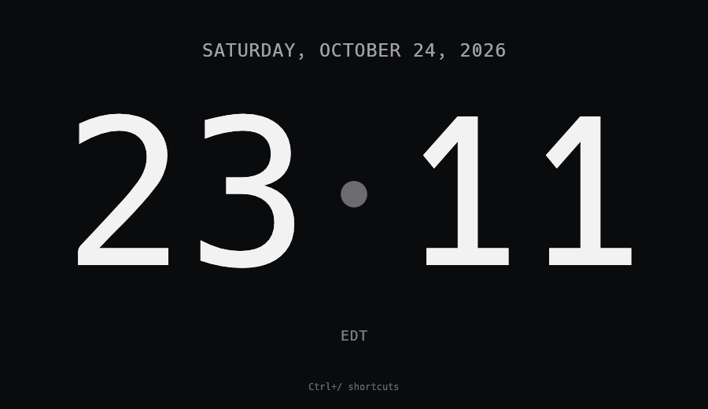

# eclock

A large desktop clock in a borderless, resizable window you can tile.



eclock reads your system time zone at startup and handles DST. At rest, it
redraws once per second with seconds shown, or once per minute otherwise.

## Run

You need Rust 1.95 or newer and a working OpenGL driver. Install a Rust
toolchain with [rustup](https://rustup.rs/).

On Debian/Ubuntu, install the build and desktop-integration prerequisites first:

```sh
sudo apt-get install libxcb-render0-dev libxcb-shape0-dev libxcb-xfixes0-dev \
  libxkbcommon-dev desktop-file-utils
```

Use equivalent packages on other Linux distributions. macOS and Windows do
not need extra system packages.

From a checkout of this repository:

```sh
cargo run --release
```

On first launch, a 1280×800 window shows your local time, date, and time zone.
Later launches restore your saved window size and position. Press `Ctrl+/` for
the keyboard shortcuts menu, or `S` to show seconds.

To build once and test the local binary directly:

```sh
cargo build --release --locked
./target/release/eclock
```

To install it as a local command:

```sh
cargo install --path . --locked
eclock
```

On Linux, register the application launcher and dock icon after installing the
command. `desktop-file-install` comes from `desktop-file-utils`. Refreshing the
icon theme makes the new icon visible to desktops that are already running:

```sh
desktop_data="${XDG_DATA_HOME:-$HOME/.local/share}"
install -Dm644 assets/icon.svg "$desktop_data/icons/hicolor/scalable/apps/eclock.svg"
touch "$desktop_data/icons/hicolor"
desktop-file-install --dir="$desktop_data/applications" \
  --set-key=Exec --set-value="\"$(command -v eclock)\"" assets/eclock.desktop
```

Reopen eclock after registering it. `cargo install` installs the executable;
the launcher gives GNOME the application identity and icon used in the dock.

## Window and tray

The clock opens visibly. On Linux it has both a tray icon and an ordinary
dock/taskbar entry so desktop tiling tools can manage it. Linux dock hiding is
managed by your desktop. On macOS it uses a menu-bar icon without a Dock entry;
on Windows it hides the taskbar entry when a tray is available.

Tiling and resizing have been tested on Ubuntu GNOME with Tiling Assistant and
Rectangle. Native macOS and Windows tiling and resizing remain unverified.

The tray menu offers **Show eclock**, **Hide eclock**, and **Quit**. Closing the
window hides it when a usable tray is available; otherwise it saves and exits.
Quit always saves preferences and exits.

On Linux, tray operation uses X11 or XWayland and requires a desktop
StatusNotifier tray host. Without both, eclock uses an ordinary taskbar entry
and closing the window exits.

## Controls

| Key / input | Action |
| --- | --- |
| `Ctrl+/` | Open/close the keyboard shortcuts menu |
| `S` | Toggle seconds |
| `+` / `=` | Zoom in |
| `-` | Zoom out |
| scroll wheel | Zoom in/out |
| `0` | Reset zoom |
| `A` | Toggle hourly alert |
| `F` | Toggle fullscreen |
| `Esc` | Close the shortcuts menu, or leave fullscreen |
| `H` | Show/hide the shortcut prompt |
| drag background | Move the window |
| drag an edge or corner | Resize the window |

The hourly alert, when enabled, tints the border near the top of the hour:
amber from `:55`, then red from `:58`.

## Settings

eclock remembers window size and position, fullscreen/maximized state, seconds
visibility, clock-text zoom, alert state, and shortcut prompt visibility in an
`app.ron` file. Zoom changes the clock text without resizing the window; display
scaling follows the OS. Window geometry saved by earlier eclock builds is
restored automatically. Settings are stored at:

- **Linux:** `$XDG_DATA_HOME/eclock/app.ron` (usually `~/.local/share/eclock/app.ron`)
- **macOS:** `~/Library/Application Support/eclock/app.ron`
- **Windows:** `%APPDATA%\eclock\data\app.ron`

Delete that file to reset the app to defaults.

## Inspect the UI

Build with the optional inspection feature and enable it at launch:

```sh
EGUI_INSPECTION=1 cargo run --features inspection
```

The egui MCP inspector can connect to `127.0.0.1:5719` to read the time, date,
and zone labels, take screenshots, resize the window, and send input.
Inspection is disabled unless enabled at runtime.

## Notes

- Icon sources are `assets/icon.svg` for the window and `assets/tray.svg` for
  the tray; rebuild after editing them. On Linux, rerun the registration commands
  above to update the dock icon too.
- Basic colors, alert timing, zoom limits, and initial window size are set in
  `src/app.rs` and `src/main.rs`.

## License

Copyright (c) 2026 Peter Szemraj.

eclock is licensed under either the [MIT License](LICENSE-MIT) or the
[Apache License, Version 2.0](LICENSE-APACHE), at your option. Dependencies,
including egui's [bundled fonts](https://github.com/emilk/egui/tree/0.37.0/crates/epaint_default_fonts/fonts),
retain their own licenses.
